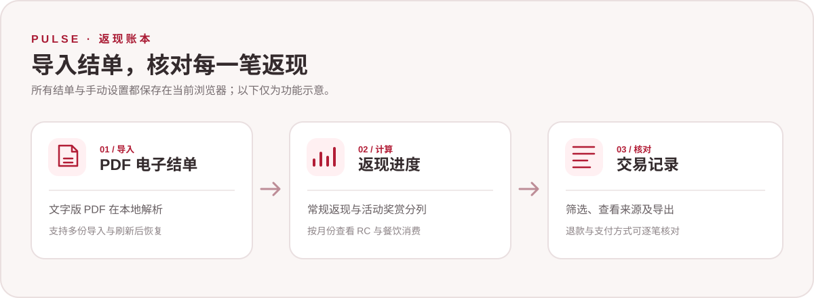
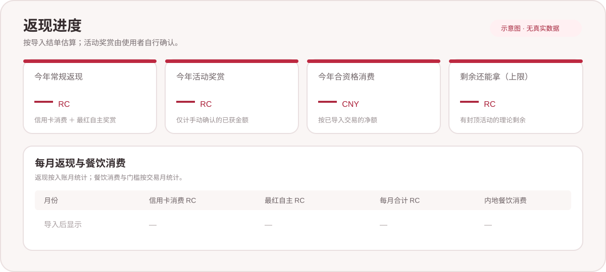
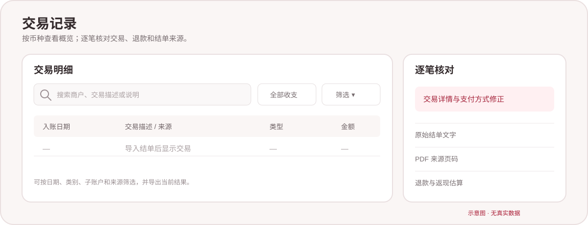

# 汇丰 Pulse 返现计算器

导入 HSBC Pulse 信用卡 PDF 结单，查看本年的返现进度、每月消费与交易明细。结单在浏览器本地解析和缓存，无需连接银行账户。公开代码不预置任何个人结单、交易或返现进度。本项目为独立开发的非官方工具，所有 RC 均为估算，请以汇丰实际发放和活动条款为准。

> **AI 生成说明：**本项目大部分代码由 AI 生成，并由维护者提出需求、调整和验证。应用运行时不调用 AI 服务。

## 功能一览



图片为功能示意，不含真实结单、交易或个人返现进度。

## 你可以用它做什么

| 功能 | 具体内容 |
| --- | --- |
| 导入与缓存结单 | 一次导入多份英文文字版电子结单；支持密码结单、解析报告和重复导入；刷新页面后从当前浏览器恢复。 |
| 查看返现进度 | 分开显示今年常规返现、已确认的活动奖赏、合资格消费及有封顶奖赏的理论剩余额度。 |
| 核对每月情况 | 逐月列出信用卡消费返现、最红自主奖赏、两项合计 RC、内地合资格签账、内地餐饮消费及门槛状态。 |
| 查看交易记录 | 按日期、币种、类别、主副卡和来源筛选；查看原始文字及 PDF；修正支付方式、地区或餐饮分类；导出筛选后的 CSV。 |

支持 **HSBC Pulse 银联双币钻石卡的英文文字版电子结单**。扫描件、图片、其他银行或未适配版式暂不支持 OCR。单份 PDF 最多 25 MB、200 页；当前页面最多 20 份，合计最多 100 MB。

## 快速开始

### 1. 保存 HSBC HK 电子结单

1. 打开 **HSBC HK** 应用，进入顶部「银行卡」。
2. 切换到「汇丰 Pulse 银联双币钻石卡－港币」。
3. 打开「电子结单和电子通知书」，选择需要的结单。
4. 点击结单右上角「分享」，再选「保存到文件」。
5. 在计算器的「导入 PDF 结单」区域选择文件，也可以把 PDF 拖入页面。可以一次选择多个文件。

若结单设有密码，导入后按页面提示输入。密码仅用于当次解密，不会保存。请导入银行下载的原始 PDF；截图、扫描件和打印成图片的 PDF 无法按文字解析。

### 2. 先核对解析结果

每份结单都可以打开「解析报告」，查看识别到的交易、来源页和结欠核对结果。工具按子账户检查：

```text
上期结欠 + 支出 - 入账 = 本期结欠
```

如果有未识别行、结欠差额或交易归属不明，请先与原结单核对，再使用返现估算。结欠一致只是校验线索，不能证明所有交易都识别正确。同一结单重复导入时会合并重复来源；同日、同商户、同金额的多笔真实消费仍会保留。

### 3. 查看返现进度



图中数值均为占位符；导入结单后才会计算个人进度。

「返现进度」按香港时间统计今年已入账的导入交易，交易列表的筛选不会改变年度汇总。页面分别显示：

- **今年常规返现**：分为「信用卡消费」和「最红自主奖赏」。前者包含基础奖赏及符合条件的 PULSE 专属奖赏；后者只计赏世界的额外奖赏，不重复计算基础部分。
- **今年活动奖赏**：只汇总你手动确认的迎新、其他活动和已领取的 Reward+ 新用户 50 RC。
- **今年合资格消费**：按已导入记录的合资格净消费估算，港币部分用公开 HKD/CNY 参考汇率折算。
- **剩余还能拿（上限）**：仅汇总仍在有效期内、有封顶奖赏的理论剩余额度；不含无上限的基础 0.4%，也不代表未来一定能获得。

「每月返现与餐饮消费」表中的**每月合计 RC＝信用卡消费＋最红自主奖赏**。返现按入账月份统计；餐饮消费和每月 1,200 元门槛按交易月份统计。内地餐饮返现另列在规则卡片中，**不计入每月合计、今年常规返现或已确认的活动奖赏**。

### 4. 确认迎新及其他活动

PDF 无法可靠判断申请渠道、发卡日、报名状态或奖赏是否已经发放。因此「已获得的活动奖赏」需要你自己填写：

| 页面字段 | 什么时候填写 | 计入方式 |
| --- | --- | --- |
| 已获得迎新奖赏 RC | 银行已实际发放迎新奖赏后，填入收到的 RC；新户额度因资格和申请渠道而异。 | 填写金额直接计入今年活动奖赏。 |
| Reward+ 新用户 50 RC | 完成活动登记并实际领取后，选择「已领取 50 RC」。 | 计入 50 RC；未领取不计。 |
| 其他活动获得 RC | 其他已经发放的活动奖赏，例如符合资格的二维码小奖赏。 | 填写金额直接计入；不要重复填写迎新或 Reward+。 |

不确定是否领取时留空或保留「未领取」。这些字段是**已获得金额**，不是自动判断的待领取资格。

## 返现如何估算

以下为当前计算引擎的主要口径。报名、地区、商户类别、支付方式、退款及银行取整都可能改变实际结果；完整说明和官方条款链接见 [解析与返现规则](docs/rules.md)。

| 奖赏 | 当前估算口径 | 消费额度或上限 |
| --- | --- | --- |
| 基础奖赏 | 合资格净消费约 **0.4%**，无需报名；港币消费按参考汇率折算后以 RC 展示。 | 无上限。 |
| 赏世界 5x／最红自主奖赏 | 默认按已报名估算；符合非香港地区与原币种条件的交易额外约 **2%**。地区不明时采用非香港兜底估算，可在交易详情修正。 | 工具当前按每卡每年 **CNY 100,000** 估算；官方以 HKD 额度规定，存在汇率差异。 |
| PULSE 专属 | 内地或澳门指定银联／Reward+ 二维码或手机付款的人民币交易额外约 **2%**。普通微信、支付宝钱包付款不自动计入。 | 每卡每半年首 **CNY 80,000** 合资格消费；两个半年分别计算。 |
| 内地餐饮 | 默认按已报名、美团按餐饮估算；需要满足当月内地合资格净签账门槛，具体商户类别仍以银行认定为准。 | 上半年按独立活动的 3%＋2% 和相应月度上限估算；下半年额外 3%，每月最多 80 RC。单独显示，不算作已获 RC。 |

同一笔消费可以同时符合基础、赏世界、PULSE 和餐饮规则，但每项分别检查条件与剩余额度。尚未入账的交易保留在明细中，暂不计入返现或占用额度。支付方式不明的已入账消费可计基础及符合条件的赏世界，**不会自动获得 PULSE 专属或餐饮奖赏**。

### 退款、汇率和主副卡

- 已入账退款会扣回对应的估算返现，但**不会恢复**赏世界年度额度或 PULSE 半年额度。无法确定原消费渠道时，请在交易详情核对并修正；如果原消费已超额而未获额外奖赏，可选择「仅扣基础返现」。
- 港币入账消费使用 [Frankfurter 公开 HKD/CNY 参考汇率](https://frankfurter.dev/)折算。页面显示汇率日期；汇率获取失败时不会编造数值，港币部分显示待折算。该请求不携带结单、交易或账户资料。
- 主卡与每张副卡分别计算返现及封顶额度。解析器根据结单中的卡号、持卡人和跨页分段归属交易；如归属有误，请以原结单核对。
- 基础 0.4% 没有固定上限，因此不存在统一的「首年总 RC 上限」。

## 交易记录与导出



图中没有真实交易；结单来源只在用户本地导入后显示。

交易概览按所选币种分别显示支出、入账和笔数，**不会把 HKD 与 CNY 直接相加**。入账总额可能包含还款、退款及其他入账；还款、费用和奖赏入账不当作合资格消费。可以搜索商户或描述，并按日期、币种、收支、交易类别、子账户及来源筛选。

打开交易详情可查看原始文字、来源结单和页码，必要时打开原 PDF 核对，并修正支付方式、地区、原币种或餐饮分类。修改会立即更新返现估算，并随结单缓存到当前浏览器。CSV 导出的是**当前筛选结果**；下载后的 CSV 由你自行保管。

## 本地缓存与隐私

- PDF、解析结果和手动设置保存在**当前浏览器的 IndexedDB**。刷新页面后可恢复；换设备、换浏览器或换站点地址不会自动同步。
- PDF 密码不保存。点击「清除本地数据」或清理浏览器站点数据，会删除当前站点缓存；请保留原始结单文件以便重新导入。
- 结单在浏览器内解析，没有业务后端、银行授权、银行 API、上传接口或运行时 AI 服务。PDF.js、Worker、字体、CMap 和 WASM 随网站发布，不从第三方 CDN 加载。
- 不要把真实结单、密码、完整卡号或个人资料提交到 GitHub Issue、PR、测试夹具或截图中。仓库测试数据均为虚构示例。

## 常见问题

| 情况 | 先检查什么 |
| --- | --- |
| PDF 解析失败 | 确认是原始英文文字版电子结单，不是扫描件；检查文件是否完整、是否需要密码，以及单份大小和页数限制。打开解析报告查看具体错误。 |
| 金额与银行不同 | 检查是否导入了所有月份、交易是否已入账、支付方式和主副卡是否识别正确、是否有退款或人工修正；返现最终以银行发放为准。 |
| PULSE 专属没有计入 | 结单中的入账币种不足以证明支付渠道。需要内地／澳门地区及明确的合资格二维码或手机付款标记；普通微信／支付宝钱包不自动计入。 |
| 餐饮消费出现但 RC 没有增加 | 餐饮返现与常规 RC 分开，且须核对报名、每月 1,200 元门槛、商户类别和活动上限。 |
| 刷新后没有缓存 | 检查浏览器是否允许站点存储、是否使用无痕模式、是否切换了浏览器或站点地址。 |

## 本地开发与部署

需要 Node.js **22.12+**；`.node-version` 指定 **22.22.0**，该发行版自带 npm。首次安装依赖并启动：

```bash
npm ci
npm run dev
```

打开终端显示的 `localhost` 地址。页面使用 Web Crypto，远程部署需通过 HTTPS 访问。修改代码后运行：

```bash
npm test
npm run build
npm run preview
```

生产文件位于 `dist/`。部署时发布**整个**目录，包括 PDF.js 的 Worker、字体、CMap、WASM 和许可文件；`dist/` 与 `node_modules/` 均不提交到 GitHub。仓库提供 `Dockerfile` 和 `wrangler.jsonc`：Cloudflare Workers 默认使用 `workers.dev` 地址，自定义域名需自行配置。上传源码**不会自动部署网页**。

项目源码位于 [`src/`](src)，回归测试位于 [`tests/`](tests)，详细计算和解析边界见 [`docs/rules.md`](docs/rules.md)。日常开发使用 `codex/develop` 分支；`main` 保留稳定版本。后续更新步骤见 [GitHub 上传说明](docs/github-upload.md)。

## 许可与来源

项目基于 [CbShuiMu/HSBCheck](https://github.com/CbShuiMu/HSBCheck) 修改，保留原项目的 [MIT 许可证](LICENSE) 和版权声明。欢迎阅读 [贡献指南](CONTRIBUTING.md) 后提交修正。HSBC 及相关商标归各自权利人所有；本项目与汇丰银行没有隶属、授权或背书关系。
